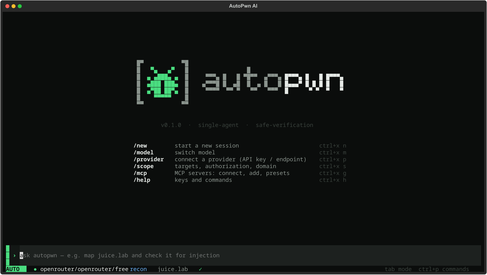
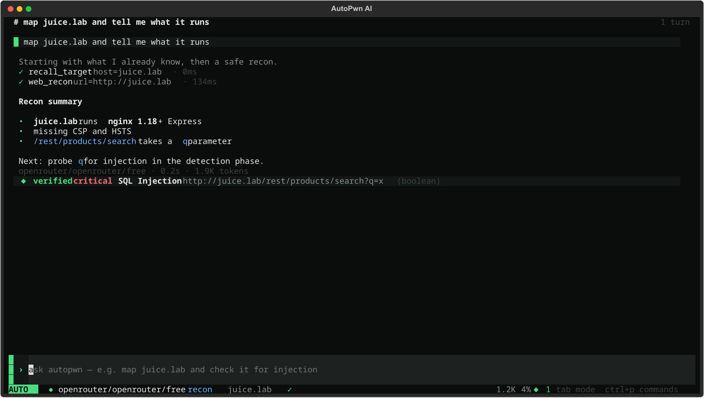
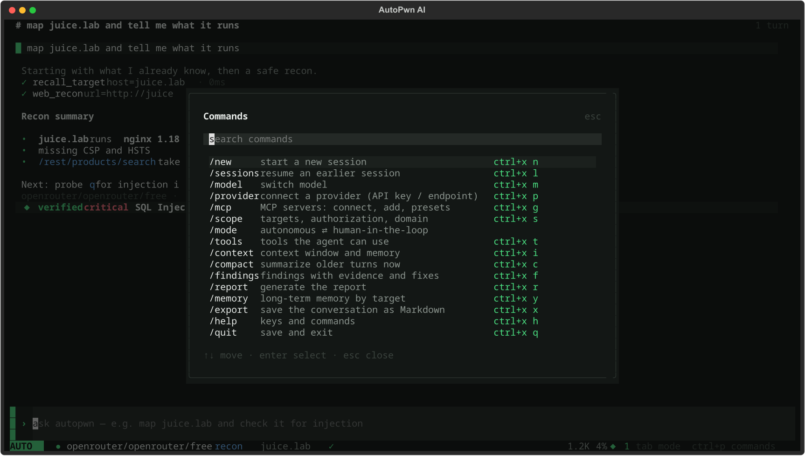
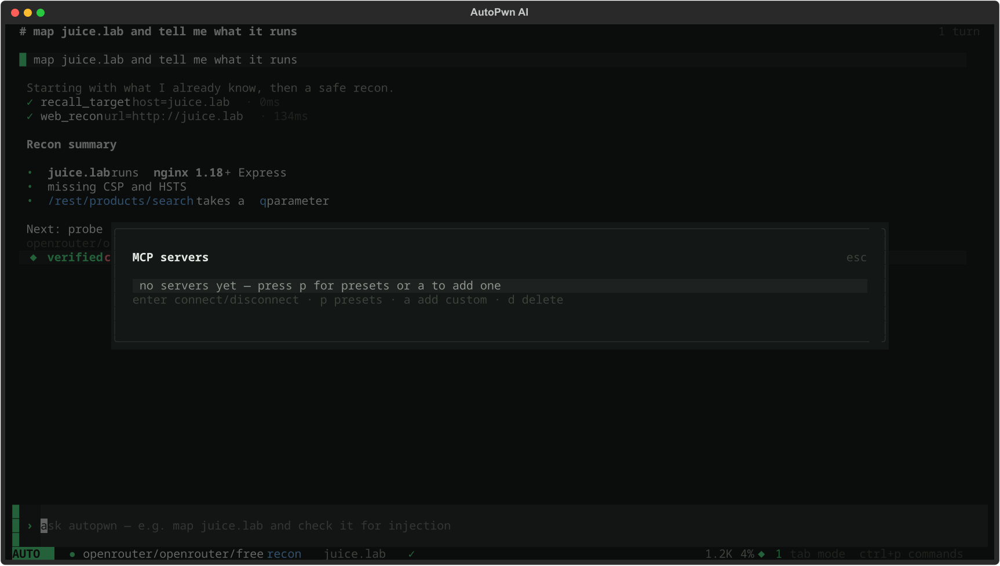
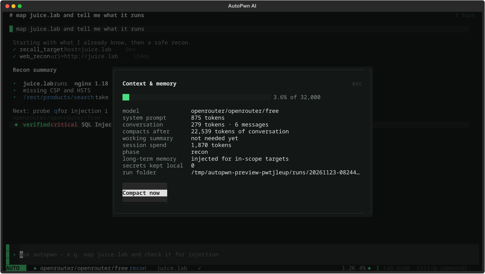

<div align="center">

```
 █████  ██    ██ ████████  ██████  ██████  ██     ██ ███    ██     █████  ██
██   ██ ██    ██    ██    ██    ██ ██   ██ ██     ██ ████   ██    ██   ██ ██
███████ ██    ██    ██    ██    ██ ██████  ██  █  ██ ██ ██  ██    ███████ ██
██   ██ ██    ██    ██    ██    ██ ██      ██ ███ ██ ██  ██ ██    ██   ██ ██
██   ██  ██████     ██     ██████  ██       ███ ███  ██   ████    ██   ██ ██
```

**Purple-Team Vulnerability Discovery Agent**

*deep detection · offensive techniques · defender-framed · safe verification*

</div>

---

AutoPwn AI is a **purple-team** security agent: it discovers vulnerabilities in
websites, systems and networks using offensive techniques, **verifies them
non-destructively**, and reports them the way a defender needs — with detection
and remediation guidance. It ships as a **self-contained** CLI/TUI with every
tool bundled, and connects to **any** LLM provider you choose.

> ⚠️ **Authorized testing only.** Use AutoPwn AI exclusively against targets you
> own or are explicitly permitted to test. It performs real actions on the
> network. You are responsible for staying within scope and the law.

## What it is (and isn't)

- ✅ Finds + **safely verifies** vulnerabilities (non-destructive proof).
- ✅ Writes professional reports (PDF / JSON / Markdown) with CVSS + fix guidance.
- ❌ Does **not** perform destructive exploitation, data exfiltration, or DoS —
  by design, those capabilities are not in the toolset.

## Features

- **Chat-driven agent** — plain-language goals; a methodology planner (OWASP WSTG,
  PTES, MASVS) runs recon → detection → verification → report.
- **Any LLM** — Anthropic, OpenAI, Gemini, OpenRouter (incl. free models), Groq,
  Mistral, DeepSeek, xAI, Together, Fireworks, Azure, Bedrock, Ollama, LM Studio or
  any OpenAI-compatible server. Keys are checked with the provider, then stored
  encrypted.
- **Real scanners, safely** — nuclei, httpx, subfinder, katana, dnsx, naabu, ffuf,
  gau and nmap, rate-limited and time-boxed; `autopwnai tools install` fetches them
  (official releases, SHA-256 verified, no root).
- **Hard scope gate** — enforced in code for every tool: hosts, `*.wildcards`, CIDR,
  out-of-scope exclusions, and an authorization ack for active testing.
- **Verified findings only** — non-destructive proofs (reflection, boolean/time
  differential, protocol checks) filter false positives before anything is reported.
- **Reports** — PDF, HTML, Markdown, JSON and **SARIF** (GitHub code scanning),
  technical or executive, with CVSS, evidence, 🔵 detection and 🔵 remediation.
- **MCP both ways** — plug in MCP servers (one-key presets or your own stdio / HTTP /
  SSE), or run `autopwnai mcp-serve` to give other MCP clients AutoPwn's tools.
- **Memory** — short-term (token-accurate context with rolling summaries) and
  long-term (per-target facts, finding history new/fixed/reopened, session episodes).
- **Terminal app** — OpenCode-style TUI, setup wizard, sessions you can resume,
  copy/export the chat (txt / md / html), human-in-the-loop approvals.
- **Governance** — secrets vaulted as `«secret:…»` placeholders, hash-chained audit
  log, encrypted local storage.

## Status

**v0.1 — production-ready engine.** The full methodology-driven agent is implemented and
tested end-to-end: config/state foundation, the think→act→observe loop with a
native + MCP tool harness, cross-domain recon, detection + **safe verification**
(the false-positive filter), professional reporting, cross-run memory, a live
Textual TUI, an evaluation harness, and a self-contained container. See the
[user guide](docs/USER_GUIDE.md) and [`docs/ARCHITECTURE.md`](docs/ARCHITECTURE.md).

## Install

One line on Linux or macOS:

```bash
curl -fsSL https://raw.githubusercontent.com/AshrafMostafaNmap/autopwn-ai/main/install.sh | sh
```

It installs [uv](https://docs.astral.sh/uv) if needed, then `autopwnai` in its own
isolated environment (with its own Python — nothing system-wide, no root), and
offers to open the setup wizard. Options go after `sh -s --`:

```bash
curl -fsSL https://raw.githubusercontent.com/AshrafMostafaNmap/autopwn-ai/main/install.sh | sh -s -- --with-browser
```

| option | |
|---|---|
| `--with-browser` | Playwright browser recon (downloads Chromium) |
| `--with-pdf` | PDF reports (needs pango/cairo) |
| `--ref v0.1.0` | a specific release or branch |
| `--uninstall` | remove it (settings and keys are kept) |

Prefer to read it first? `curl -fsSL …/install.sh -o install.sh && less install.sh && sh install.sh`.
Already have uv or pipx: `uv tool install git+https://github.com/AshrafMostafaNmap/autopwn-ai`
(or `pipx install git+…`). Update by running the installer again.

From source, for development:

```bash
git clone https://github.com/AshrafMostafaNmap/autopwn-ai && cd autopwn-ai
python -m venv .venv && . .venv/bin/activate && pip install -e ".[dev]"
```

## Quick start

```bash
autopwnai
```

The first launch opens a short **setup**: confirm authorized use, pick the
providers you have (keys and local servers already on the machine are detected),
paste keys — each one is **checked with the provider** and stored **encrypted on
your machine** — choose a default model, the working mode and optional MCP
servers. `autopwnai setup` (or `/setup`) runs it again. Then just chat:

> *map juice.company.lab and check it for injection*

Inside the app, plain text goes to the agent. Type `/` for commands (they
autocomplete), or press **Ctrl+P** for the command menu:

| command | what it does |
|---|---|
| `/model` | pick a tool-capable model (or `/model openai/gpt-5.5`) |
| `/provider` | connect a provider — API key / endpoint, stored locally |
| `/mcp` | MCP servers: one-key presets, or your own (stdio / HTTP / SSE) |
| `/tools` | every tool the agent has, and which ones ask before running |
| `/scope` | targets, out-of-scope, domain, **authorization**, run mode |
| `/context` | context-window use, tokens, phase, compaction |
| `/findings` | findings with evidence, safe proof, detection and fix |
| `/report` | PDF / HTML / JSON / Markdown, technical or executive |
| `/memory` | what is remembered about targets across runs |
| `/sessions` | resume an earlier session where you left off |
| `/setup` | the setup wizard again (providers, keys, model, preferences) |
| `/export` | the whole chat as a clean `.txt` (or Markdown / HTML) |
| `/copy` | last answer to the clipboard (`/copy 2` = answer #2, `/copy all` = the whole chat) |
| `/mode` · `/compact` · `/export` · `/new` · `/help` · `/quit` | session controls |

Keys: **Tab** autonomous ⇄ human-in-the-loop · **Esc** interrupts a running turn ·
**Ctrl+P** command menu · **Ctrl+X** then a letter (e.g. `m` model, `n` new,
`l` sessions, `g` MCP) · **↑/↓** prompt history · **mouse drag** selects chat text ·
**Ctrl+C** copies the selection (or clears the prompt; press twice to save & quit).

The same engine from the shell:

```bash
autopwnai connect anthropic          # store a key (hidden prompt, encrypted)
autopwnai models anthropic           # tool-capable models you can pick
autopwnai doctor                     # is the active model ready?
autopwnai export                     # latest chat → clean .txt (--format md|html, --list, -o)
autopwnai run "assess juice.company.lab for SQLi and XSS, then report" \
    -t juice.company.lab --authorize # one-shot, prints the result
autopwnai tools install              # scanners: nuclei, httpx, subfinder, katana, dnsx, naabu, ffuf, gau
autopwnai mcp-serve -t app.lab --authorize   # AutoPwn's tools for any MCP client
autopwnai eval                       # offline benchmark harness
```

Run with zero host dependencies (every scanner bundled):

```bash
docker build -t autopwn . && \
docker run --rm -e ANTHROPIC_API_KEY=$ANTHROPIC_API_KEY autopwn \
    run "assess example.lab" -t example.lab --authorize
```

## Safety model

- **Authorized only** — a scope prompt + an acknowledgement (`--authorize`) are
  required; everything is recorded in a hash-chained audit log.
- **Safe verification only** — findings are confirmed with non-destructive proofs
  (reflection, boolean differential, read-only protocol checks). No destructive
  exploitation, exfiltration, or DoS — those are not in the toolset.
- **Secrets stay local** — a secret vault tokenizes credentials/cookies into
  placeholders; the LLM never sees a real secret value.

## Docs

- [User guide](docs/USER_GUIDE.md) — install, provider setup, usage, safety.
- [Architecture](docs/ARCHITECTURE.md) — identity, scope, agent flow, governance.
- [Build plan](docs/ROADMAP.md) — phases and their status.
- [Security policy](SECURITY.md) — reporting issues, responsible use, key handling.

## Previews

| Home | Session |
|---|---|
|  |  |

| Command menu | MCP servers | Context |
|---|---|---|
|  |  |  |

Regenerate them with `python tools/preview.py`.
