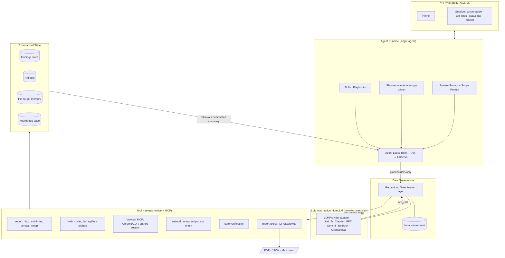

# AutoPwn AI — Architecture & Design

> **Purple-Team Vulnerability Discovery Agent**
> Deep, professional, offensive-technique detection — framed for the defender.
> Python-first · self-contained · CLI/TUI · provider-agnostic LLM.

This document is the single source of truth for the system design. It is the
output of a full requirements pass; every decision below was explicitly agreed,
and the "Deferred (v2)" notes record what we intentionally pushed to later.

---

## 1. Identity & Mission

| | |
|---|---|
| **Type** | **Purple Team** — strongest-possible detection using offensive techniques, written up for the defender (detection + remediation guidance per finding). |
| **Exploitation cap** | **Level 1 — Safe Verification only.** Confirms a vulnerability with a *non-destructive* proof (boolean/time-based, reflection, differential responses). **No** data exfiltration, **no** destructive exploitation. |
| **Name / brand** | `autopwn ai` — gray `auto` + green `pwn ai`, pixel bug mark. |
| **Users** | universities · small companies · individual purple-teamers. |
| **Domains** | **Web** apps/sites · **Networking** (incl. local/LAN) · **Servers/Infra** · **Android** apps. Primary focus: web, networking, server security. |
| **Interface** | **conversational** — you talk to the agent in natural language (chat); it understands intent, plans, and acts. No command syntax to learn. |
| **Non-negotiable** | authorized targets only; the tool protects client data, never leaks it. |

The Safe-Verification stage is also the **false-positive filter**: a finding is
only reported *after* it is safely verified. This is how we reconcile the two
eval goals (high coverage **and** low hallucination).

---

## 1.5 Target Domains & Coverage

AutoPwn works across four domains; one agent, domain-specific tools + playbooks.

| Domain | Scope | v1 depth |
|--------|-------|----------|
| 🌐 **Web** *(primary)* | sites & web apps, APIs | OWASP WSTG / Top-10: SQLi, XSS, SSRF, IDOR, auth, access control, misconfig… |
| 🖧 **Networking** *(primary, incl. local/LAN)* | hosts, ports, services on a range/CIDR | host discovery, service/version enum, weak/exposed services, known-CVE surfacing |
| 🖥️ **Servers / Infra** *(primary)* | the server behind a target | misconfig, exposed panels/services, outdated software, TLS/headers |
| 📱 **Android apps** | an `.apk` + its backend | static analysis (secrets, insecure storage, exported components, weak crypto) + its API testing. *Deeper dynamic/instrumented analysis → later.* |

All domains obey the same rules: authorized scope, safe (non-destructive)
verification, redaction, and defender-framed findings. The tool harness bundles
**powerful, best-in-class tools** per domain (see Tech Stack §8 and ROADMAP P2–P3).

## 2. Decision Record (the 11 branches)

| # | Branch | Decision | Deferred → v2 |
|---|--------|----------|---------------|
| 1 | Identity | Purple, safe-verification (L1) | full exploitation (never, by design) |
| 2 | Scope / Authz | **Soft scope** via Scope Prompt + full trust + signed acknowledgement log | hard allowlist gate at tool layer |
| 3 | Autonomy | Two modes: **Autonomous** & **Human-in-the-loop** | fine-grained gate points |
| 4 | Runtime | **Self-contained container**, all tools bundled; **CLI/TUI**; Linux-first | Windows/Mac host |
| 5 | Architecture | **Single agent**, hybrid, **methodology-driven planner** | orchestrator + sub-agents |
| 6 | Tool Harness | **Native + MCP** hybrid, Skills/playbooks, full lifecycle incl. report tools, Chrome MCP, authenticated scanning | — |
| — | Data Governance | **Redaction** — secret *values* never leave the machine; LLM sees placeholders, harness injects locally at execution | — |
| 7 | Memory | **Externalized state + retrieval**, per-phase compaction, **per-target memory** persists across runs | — |
| 8 | LLM | **Single model** (v1), tool-calling mandatory, **provider-agnostic** abstraction | model routing |
| 9 | Reporting | **PDF + JSON + Markdown**, **CVSS + priority**, defender-framed findings, pluggable styles | HTML/SARIF |
| 10 | Evaluation | automated scored benchmark + human expert review; target ~99% detection, very low FP, high depth | — |
| 11 | Boundaries | legal ack + behavior in system prompt + **non-destruction by toolset curation** | — |

---

## 3. High-Level Architecture



**Key invariant:** everything the LLM sees is routed through the Redaction
layer. Real secret values live only in the local vault and are re-injected by
the harness at the moment a tool actually executes — on our machine.

---

## 4. The Agent Flow (methodology-driven)

```
            ┌─────────────────────────────────────────────────────────┐
            │                    AGENT LOOP (single)                   │
            │                                                          │
 target ──▶ │  1. DEEP RECON ───▶ 2. PLANNING ───▶ 3. DETECTION ──┐    │
            │   understand        pick OWASP/PTES   methodology    │    │
            │   stack, arch,      build pipeline,   loop, free     │    │
            │   attack surface    choose tools      within phase   │    │
            │                                            │         │    │
            │        ┌───────────── 4. SAFE VERIFY ◀─────┘         │    │
            │        │   non-destructive proof  (FP filter)        │    │
            │        ▼                                             │    │
            │   5. REPORTING ◀── loop until target coverage done ──┘    │
            └─────────────────────────────────────────────────────────┘
```

- **Understand before plan:** recon runs first and builds a complete picture;
  only then does the planner choose a methodology and toolchain.
- **Termination = coverage, not step count.** ⚠️ Open design task: define a
  concrete *coverage-complete* signal so the loop cannot run forever
  (checklist-of-surface coverage + no-new-findings plateau + optional budget).
- Autonomous mode runs the whole flow; HITL mode pauses at phase boundaries
  and before any state-touching action for approval.

---

## 5. Findings Schema (lives in the state store, drives the report)

```jsonc
{
  "id": "APW-001",
  "title": "SQL Injection in 'cat' parameter",
  "type": { "owasp": "A03:2021-Injection", "cwe": "CWE-89" },
  "target": { "url": "/listproducts.php", "param": "cat", "host": "testphp.vulnweb.com" },
  "severity": { "cvss_score": 9.8, "cvss_vector": "CVSS:3.1/AV:N/AC:L/...", "rating": "critical" },
  "evidence": { "request": "...", "response": "...", "screenshot": "art/apw-001.png", "steps": ["..."] },
  "safe_poc": "boolean+time-based differential; no data extracted",
  "detection_guidance": "WAF rule / log signature the blue team can deploy",   // 🔵 purple value
  "remediation": "parameterised queries; input validation",                     // 🔵 purple value
  "confidence": 0.98,
  "status": "verified"            // verified | suspected
}
```

The two 🔵 fields are what make this **purple**, not just a scanner.

---

## 6. Data Governance (secret handling)

```
 browser/tool captures cookie/token/PII
        │
        ▼
 ┌──────────────┐    store real value     ┌───────────────────┐
 │  Redaction   │ ──────────────────────▶ │ local secret vault│  (encrypted at rest)
 │   layer      │                          └───────────────────┘
 │              │    emit {{SESSION_COOKIE}} placeholder
 │              │ ─────────────────────────────▶  LLM context (external API)
 └──────────────┘
        ▲   at tool-execution time, swap placeholder → real value (LOCAL ONLY)
        └───────────────────────────────────────────────────────────────────
```

- The external LLM **never** receives raw secrets — only references.
- Privacy-sensitive users can plug a **local model**; then even placeholders
  stay on-box. Two layers of protection.

---

## 7. Memory & Context Management ("the beast")

- **Externalized state + retrieval:** raw tool output → stores, **not** the
  context window. Context holds a compact working summary + a findings index.
- **Short-term memory (`Conversation`):** one system message (prompt + rolling
  working summary) followed by verbatim turns. The budget is computed in real
  tokens for the active model: `(window − reply reserve − system) × 0.85`,
  capped at 150k. When it is exceeded, at the start of a user turn, the oldest
  turns are folded into the summary (LLM-written, deterministic fallback); tool
  calls and their results are never split. History is also compacted at phase
  boundaries when it is past half the budget.
- **Long-term memory (`TargetMemory`):** encrypted per-target facts, finding
  history (new / fixed / reopened) and one episode summary per session. A brief
  of it is injected into the system prompt every turn.
- **Sessions:** the conversation and state are saved after every turn and can
  be resumed (`/sessions`).
- **Transcript:** independently of compaction, `runs/<id>/transcript.jsonl`
  records every question, narration, tool call/result, verified finding and
  answer (from the redacting event logger). `/export` and `autopwnai export`
  render it to Markdown or HTML (`autopwn/transcript.py`).
- **Retrieval tools:** the agent queries details on demand instead of carrying
  everything.
- **Per-target memory** persists across runs → re-scanning the same target is
  smarter each time.
- **Knowledge base:** signatures, techniques, lessons from past findings.

---

## 8. Tech Stack (Python-first)

| Layer | Choice |
|-------|--------|
| Language | Python 3.12+ |
| TUI | Rich + Textual |
| LLM abstraction | a thin `LLMProvider` adapter over **LiteLLM** (one OpenAI-style API to 100+ providers — Anthropic/OpenAI/Gemini/Bedrock/Azure + local via Ollama/vLLM — with tool-calling, streaming, cost tracking) + MCP SDK |
| Browser | Playwright / CDP + Browser MCP |
| Security tools | nmap, httpx, nuclei, subfinder/amass, ffuf, sqlmap (safe mode), nikto … (bundled) |
| State | SQLite/Postgres (findings) + files (artifacts); encryption at rest |
| Reporting | Jinja2 + WeasyPrint (PDF) + JSON/Markdown |
| Packaging | Docker (Linux base) |
| Eval | pytest harness over benchmark targets (Juice Shop, DVWA, WebGoat, bWAPP, custom VMs) |

### 8.1 LLM Integration Layer — the engine that connects every provider

**Decision: [LiteLLM](https://github.com/BerriAI/litellm), wrapped behind our own thin `LLMProvider` adapter.**

Chosen after a web-research pass as the **strongest, most battle-tested** option
for a provider-agnostic agent:

- **One API → 100+ providers** in OpenAI format — Anthropic, OpenAI, Gemini/Vertex,
  Bedrock, Azure, Mistral, Groq… and **local models** via Ollama / vLLM.
- **Tool-calling normalized across providers** — we define a tool once; LiteLLM
  translates it to each provider's format and returns unified `tool_calls`.
  (Our tool-calling-mandatory rule is enforced with `supports_function_calling(model)`
  at startup — a model that can't do tools is refused.)
- **Streaming + token/cost tracking**, embeddable as a Python SDK (no server needed).
- **BYO key:** the user sets provider + key; switching provider = change the model
  string. Privacy-sensitive users point it at a **local** model.

**Why wrapped behind our own `LLMProvider`:** so we are never locked in. If we
later prefer [any-llm](https://github.com/mozilla-ai/any-llm) (lighter, official-SDK
based) or direct SDKs, we swap the implementation, not the agent. OpenRouter can be
supported as *one* provider inside this layer for teams who want a hosted gateway;
LangChain/LlamaIndex are intentionally **not** used — we build our own agent loop.

```
agent loop ──(tools defined once)──▶ LLMProvider ──▶ LiteLLM ──▶ any provider / local
            ◀──(unified tool_calls)──                         (OpenAI-format in/out)
```

---

## 9. Evaluation

- **Automated, scored** (regression suite): known-vuln targets with a
  ground-truth list → Detection Rate, **False Positives** (the key metric),
  False Negatives, time, cost, depth.
- **Human expert review** (rubric): report quality, depth, purple-framing.
- **Success bar:** ~99% detection coverage · very low hallucination · high scan
  depth · time reasonable (secondary) · cost not a constraint.

---

## 10. Repository Layout

```
AutoPwn AI/
├── autopwn/
│   ├── cli.py              # `autopwnai`: app (default) · run · doctor · providers · connect · models · eval
│   ├── engine.py           # EngineSession — the ONE place the engine is assembled (CLI + app)
│   ├── settings.py         # per-user settings + encrypted provider-key store
│   ├── transcript.py       # full chat log + text/Markdown/HTML export
│   ├── onboarding.py       # first-run scan: usable providers, installed scanners, install hints
│   ├── config.py           # layered config (defaults → toml → app settings → env)
│   ├── core/               # run context, structured logger, SQLite state, findings model
│   │   ├── context.py      # RunContext: run dir, logger, store
│   │   ├── logging.py      # hash-safe event log (events.jsonl) + redaction
│   │   ├── store.py        # SQLite: runs/targets/findings/artifacts/memory
│   │   └── findings.py     # Finding dataclass (schema §5)
│   ├── llm/                # provider-agnostic LLM adapter over LiteLLM
│   │   ├── provider.py     # Message/ToolSpec/ToolCall types + tool-calling gate
│   │   ├── catalog.py      # providers + live tool-capable model lists
│   │   ├── tokens.py       # per-model token counting + context window size
│   │   └── keycheck.py     # verify a key with the provider before saving it (no tokens spent)
│   ├── mcp/                # Model Context Protocol
│   │   ├── config.py       # server config (stdio / streamable HTTP / SSE)
│   │   ├── client.py       # one connection on its own event loop; reconnect
│   │   ├── bridge.py       # MCP tools → ToolRegistry (server__tool)
│   │   ├── presets.py      # ready-made servers (fetch, filesystem, git, …)
│   │   ├── server.py       # `autopwnai mcp-serve`: AutoPwn's own tools over MCP
│   │   └── manager.py      # connect / disconnect / status for a session
│   ├── agent/              # the brain
│   │   ├── loop.py         # think → act → observe + budget guard
│   │   ├── tools.py        # native tool harness (registry + dispatch)
│   │   ├── planner.py      # phase state machine + methodology
│   │   ├── conversation.py # short-term memory: token budget + rolling summary
│   │   ├── modes.py        # autonomous / HITL + approval gate
│   │   ├── prompts.py      # system + scope + playbook assembly
│   │   └── builtins.py     # control tools (advance_phase/finish/…)
│   ├── govern/             # data governance + security
│   │   ├── scope.py        # hard scope gate: hosts / *.wildcards / CIDR / URLs + authorization
│   │   ├── vault.py        # local secret vault (encrypted, tokenize/inject)
│   │   ├── redaction.py    # pattern redaction (defense in depth)
│   │   └── audit.py        # hash-chained audit log + authorization ack
│   ├── browser/            # real headless browser for the agent
│   │   ├── engine.py       # Playwright on its own thread; DevTools-style capture; scope per hop
│   │   ├── tools.py        # browser_* tools: one per DevTools tab + crawl, audit, DOM XSS, login
│   │   ├── checks.py       # passive client-side checks (headers, CSP, CORS, storage, libs, secrets)
│   │   └── workflow.py     # web_deep_scan: the full web methodology in one call
│   ├── recon/              # cross-domain recon (web/network/server/mobile)
│   │   ├── runner.py       # safe subprocess runner (allowlist, argv-only)
│   │   ├── scanners.py     # agent tools over httpx/subfinder/dnsx/gau/katana/ffuf/nuclei
│   │   ├── installer.py    # `autopwnai tools`: official releases, SHA-256 verified, no root
│   │   └── target_model.py # per-host attack-surface picture
│   ├── detect/             # detection + safe verification
│   │   ├── signatures.py   # VULN_CLASSES (CVSS table) + signatures
│   │   ├── verify.py       # safe-verification engine (the FP filter)
│   │   ├── pipeline.py     # dedup → CVSS → suspected→verified
│   │   └── coverage.py     # "coverage-complete" signal
│   ├── report/             # JSON/Markdown/HTML/PDF, technical/executive styles
│   ├── memory/             # long-term: target facts, finding history, episodes, brief
│   ├── eval/               # benchmark harness + metrics + graders
│   ├── playbooks/          # per-domain methodology (Markdown)
│   ├── tui/                # the terminal app (Textual)
│   │   ├── app.py          # app shell: engine events, HITL bridge, Ctrl+P / Ctrl+X, sessions
│   │   ├── main.py         # home + session view, prompt, `/` completion, status bar
│   │   ├── messages.py     # conversation widgets (user, narration, tool line, finding…)
│   │   ├── dialogs.py      # searchable pickers: model · provider · MCP · scope · report · …
│   │   ├── setup.py        # first-run setup wizard (also `autopwnai setup` / `/setup`)
│   │   ├── commands.py     # the /command table (shared by `/`, Ctrl+P and Ctrl+X)
│   │   └── app.tcss        # brand palette styles
│   └── ui/                 # brand: theme · pixel-logo banner
├── tools/preview.py        # renders docs/preview/*.svg|png
├── benchmarks/             # eval ground-truth catalogue (local + external targets)
├── install.sh              # one-line installer (uv tool, isolated, no root)
├── .github/workflows/      # CI: lint + tests on 3.12–3.14, installer smoke test
├── Dockerfile              # self-contained image (bundles the scanners)
├── docs/                   # ARCHITECTURE · ROADMAP · USER_GUIDE · preview/
└── pyproject.toml
```

### 10.1 Runtime structure (how a session is assembled)

```
autopwnai ──▶ tui.AutoPwnApp ──┐                      ┌──▶ LLMProvider ─▶ LiteLLM ─▶ any provider
autopwnai run ─────────────────┴──▶ EngineSession ────┼──▶ ToolRegistry: native recon/detect/report/memory + MCP
                                     (engine.py)      ├──▶ Vault · Redactor · AuditLog (governance)
                                                      ├──▶ FindingsPipeline · SafeVerifier · Coverage
                                                      └──▶ TargetMemory · KnowledgeBase · Conversation
```

- **One assembly point.** `EngineSession` builds every component once; the app
  and the one-shot CLI both use it, so there is a single wiring to test.
- **Threading.** A chat turn (`EngineSession.chat`) blocks for the whole turn and
  runs in a worker thread. The SQLite stores and the event log are lock-guarded
  and usable across threads. Engine events reach the UI through log *sinks* →
  `post_message` (thread-safe); approvals block the agent thread on a UI modal.
- **Per-turn budget.** Step/token/time guards reset on every message, so a long
  conversation never starves later requests; session totals are kept separately.
- **Provider resolution.** Model id → provider (catalog) → key from the encrypted
  local store, else the provider's environment variable; local runtimes need none.
  The startup gate rejects models the catalog *knows* cannot call tools and
  allows unknown ones with a warning.
- **Scope gate.** `ToolRegistry.dispatch` asks the `ScopeGuard` before any tool
  marked `scoped` runs: every target argument must match an in-scope entry and no
  out-of-scope entry; tools marked `active` also need the authorization ack. The
  model cannot talk its way past it — it is code, not prompt.
- **Scanners.** Binaries resolve from AutoPwn's bin dir, then `~/go/bin`, then
  `PATH` (the Python `httpx` CLI is ignored). Each scanner tool runs rate-limited
  and time-boxed through the allowlisted runner; nuclei excludes intrusive tags and
  its matches enter the findings pipeline as suspected findings.
- **MCP.** Each server runs on its own event-loop thread; its whole session lives
  in one task (anyio requirement), stderr goes to `runs/<id>/mcp-<name>.log`,
  tool names are provider-safe (`server__tool`), and untrusted servers' tools
  require approval. stdio, streamable HTTP and SSE transports are supported; a
  dropped connection is re-established once per call.

---

## 11. Roadmap

- **v0.1 (now):** brand + TUI template, architecture, findings model, project skeleton.
- **v0.2:** agent loop + LLM adapter + recon tools + externalized state.
- **v0.3:** web detection + safe verification + findings pipeline.
- **v0.4:** reporting (PDF/JSON/MD) + benchmark harness.
- **v1.0:** full methodology coverage, per-target memory, eval at target bar.
- **v2 (deferred):** hard scope gate · multi-agent · model routing · HTML/SARIF.
